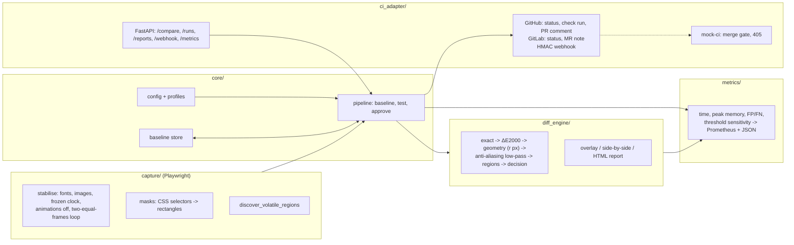

# Architecture

Five modules with one-directional dependencies. The comparison engine knows nothing about browsers or CI;
the capture module knows nothing about thresholds; `core` wires them together.

## Comparison pipeline

Each stage removes one kind of non-regression; what survives all of them is grouped into regions and counted.

| stage | removes | parameter (profile `balanced`) |
|---|---|---|
| exact | identical pixels | – |
| colour | differences below a perceptual threshold (CIEDE2000) | `color.delta_e` |
| geometry | sub-pixel shifts: a pixel is accepted if it matches (after blending) any neighbour within radius *r* | `geometry.radius_px` |
| anti-aliasing | glyph-edge noise: both images are low-pass filtered (Gaussian σ) and re-compared with their own ΔE tolerance | `antialiasing.blur_sigma_px`, `.delta_e` |
| regions | isolated specks: surviving pixels are merged into regions, regions smaller than `min_area_px` are dropped | `regions.merge_px`, `.min_area_px` |
| decision | – | `decision.fail_pixels` (pixels in surviving regions) |

Ignore masks (`mask_selectors`, `mask_regions`, auto-discovered volatile regions) are subtracted before the first stage.
The calibrated values come from `results/calibration.json`; `vrt profiles` prints them.

## Exit codes and CI contract

`vrt test` returns **0** (all pages passed), **1** (at least one visual difference) or **2** (error: missing baseline, capture failure,
bad config). CI reporters publish a commit status `vrt/visual-regression` (`success` / `failure` / `error`), a check run with the summary
and a single PR comment that is updated in place (marker `<!-- vrt-report -->`). A required status check turns exit code 1 into a blocked merge.

## Module map

| directory | content |
|---|---|
| `core/` | `cli.py`, `config.py` (YAML + `${ENV:-default}`), `profiles.py` (strict / balanced / lenient), `pipeline.py`, `store.py` |
| `capture/` | `browser.py` (session, capture), `stabilize.py` (JS/CSS stabilisation), `stability.py` (volatile-region discovery) |
| `diff_engine/` | `engine.py`, `color.py` (sRGB→Lab, CIE76/94/2000), `similarity.py` (SSIM, PSNR, pHash), `report.py` |
| `ci_adapter/` | `context.py` (CI detection), `reporters.py`, `server.py` (FastAPI), `mock_ci.py`, `render.py` |
| `metrics/` | `stats.py` (confusion, Wilson, ROC/AUC, McNemar, thresholds), `profiling.py`, `registry.py` |
| `test_dataset/` | scene generator, mutation catalogue, labelling rules, holdout / sensitivity builders |
| `experiments/` | grid search, calibration, analysis, capture-stability ablation, load test, figures |

The directories are named with underscores (`diff_engine`) because Python packages cannot contain hyphens;
the layout otherwise follows the brief.
